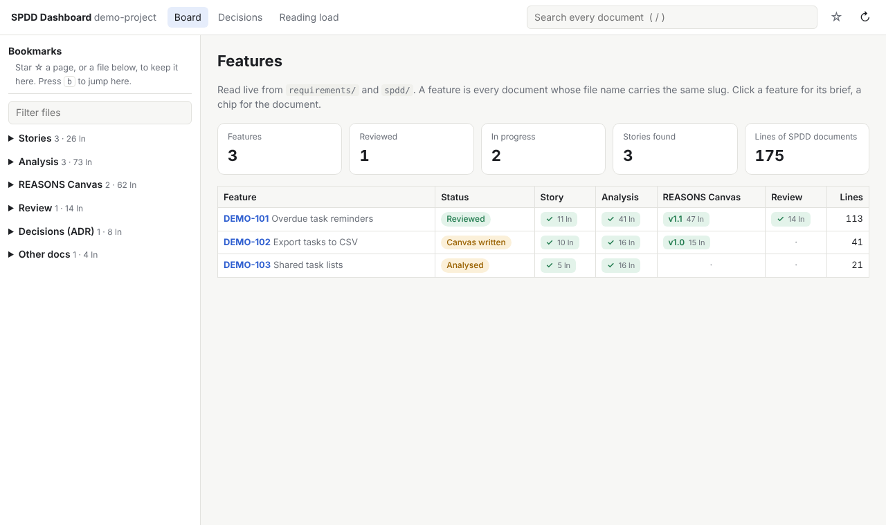
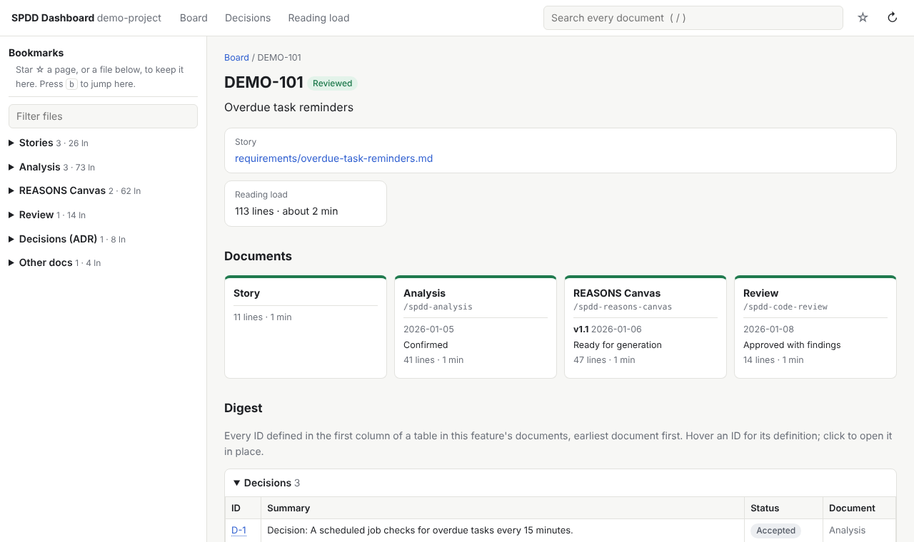
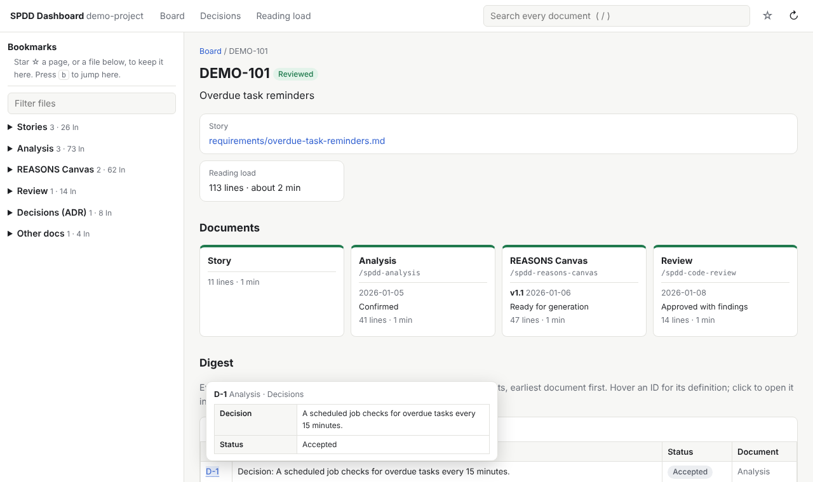
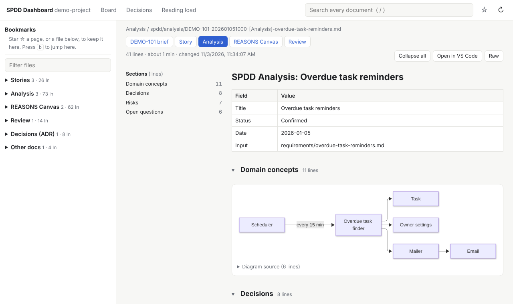
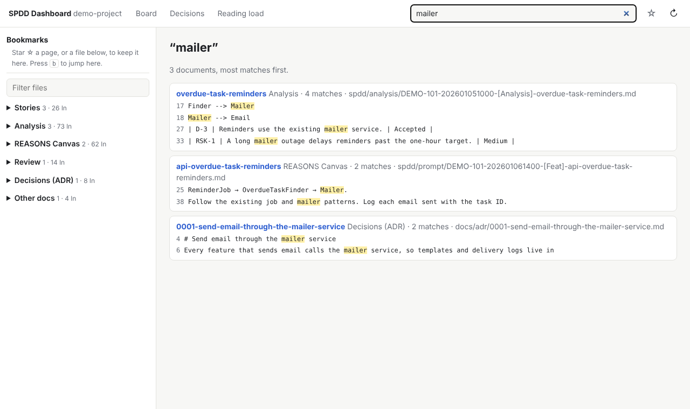

# SPDD Dashboard

A local, read-only web app for reading a repository's SPDD documents in one place.

SPDD (Structured-Prompt-Driven Development, [open-spdd](https://github.com/gszhangwei/open-spdd))
turns a user story into three documents before and after code is generated:

| Folder | Document | Written by |
|---|---|---|
| `requirements/` | The user story, any file name | You |
| `spdd/analysis/` | Analysis of the story | `/spdd-analysis` |
| `spdd/prompt/` | REASONS Canvas: the design the code is generated from | `/spdd-reasons-canvas` |
| `spdd/review/` | Review of the generated code | `/spdd-code-review` |

The dashboard reads these folders and shows, for each feature, which documents exist, what they
decided, and how much there is to read.



## Try it on the demo project

`examples/demo-project/` is a made-up task app with documents for three features.

```bash
npm install
```

```bash
npm start -- examples/demo-project
```

Open http://localhost:4400. Then:

1. Click **DEMO-101** for its brief: story, documents, digest and history.
2. Hover any ID in the Digest, such as `D-1`, to read its definition.
3. Click **Analysis** in the brief to read the document, with its diagram drawn.
4. Press `/` and search for `mailer`.

## Run it on your repository

Needs Node.js 22 or later. Pick one way:

| Way | Use it for | What it does |
|---|---|---|
| `npx` | Trying it once | Downloads this repository into npm's cache (`~/.npm/_npx/`), installs its dependencies there, and runs it. Nothing is added to your repository or your PATH. |
| `npm install -g` | Using it often | Installs a `spdd-dashboard` command on your PATH, like any global npm tool. |

Both get the code from this GitHub repository; the package is not on the npm registry.

### Try it once with npx

In your repository's folder:

```bash
npx github:janesenaj42/spdd-dashboard
```

`github:janesenaj42/spdd-dashboard` tells npm to fetch the package from this repository instead
of the npm registry. npx asks `Ok to proceed? (y)` before installing: answer `y`. Every run
fetches the repository again, so it always runs the latest version and needs network access.

### Install it to keep

```bash
npm install -g github:janesenaj42/spdd-dashboard
```

Then, in your repository's folder:

```bash
spdd-dashboard
```

| Task | Command |
|---|---|
| Update to the latest version | `npm install -g github:janesenaj42/spdd-dashboard` again |
| Remove it | `npm uninstall -g spdd-dashboard` |

### Options

Both ways read the current folder and open on http://localhost:4400. The server accepts
connections from other machines too: anyone who can reach the port can read the documents.

| Option | Example |
|---|---|
| Read another folder | `spdd-dashboard ../your-repo` |
| Another port | `PORT=4500 spdd-dashboard` |
| Accept connections from this machine only | `HOST=127.0.0.1 spdd-dashboard` |
| Print what it finds, without starting the server | `spdd-dashboard --check` |

With `npx`, put the same options after the package name:
`npx github:janesenaj42/spdd-dashboard ../your-repo --check`.

Example `--check` output:

```text
Folder: /home/you/your-repo
Features: 3

  DEMO-101                 Reviewed                 Story | Analysis | REASONS Canvas | Review
  DEMO-102                 Canvas written           Story | Analysis | REASONS Canvas | ·
  DEMO-103                 Analysed                 Story | Analysis | · | ·
```

## How documents become features

A feature is every document whose file name carries the same slug. open-spdd names files
`<KEY>-<timestamp>-[<Tag>]-<slug>.md`, for example
`DEMO-101-202601051000-[Analysis]-overdue-task-reminders.md`.

| Part | Rule |
|---|---|
| Slug | `api-overdue-task-reminders` and `overdue-task-reminders` are the same feature: a prefix such as `api-` or `web-` is ignored. A `-V2` suffix is ignored. |
| ID | The ticket key, `DEMO-101`. A key with no digit gets its timestamp appended. |
| Status | The furthest folder with a document: Analysed, Canvas written or Reviewed. |
| Story | The `requirements/` file a document cites by path, else the one whose file name or first heading contains the feature's title. |

`--check` lists any document whose file name does not fit this pattern.

## Screens

| Feature brief | ID definition on hover |
|---|---|
|  |  |

| Reader with a Mermaid diagram | Search |
|---|---|
|  |  |

## Gotchas

- The Digest lists IDs in the first column of a table, with prefixes such as `D-` (decision),
  `RSK-` (risk), `OQ-` (open question), `OP-` (operation), `T-` (test) and `RF-` (review
  finding). Documents without such tables have an empty Digest.
- Dates in the History come from `git log`. Outside a git repository every document shows
  "no date".
- Bookmarks (☆) are kept in the browser's local storage for the port in use.

## Tests

```bash
npm test
```

## Credits

Originally written by Stanley Loh ([@qsl17](https://github.com/qsl17)).
