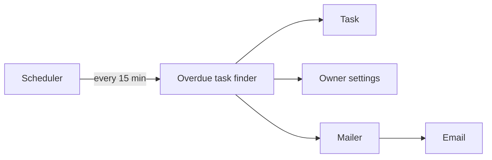

# SPDD Analysis: Overdue task reminders

| Field | Value |
|---|---|
| Title | Overdue task reminders |
| Status | Confirmed |
| Date | 2026-01-05 |
| Input | requirements/overdue-task-reminders.md |

## Domain concepts

## Decisions

| ID | Decision | Status |
|---|---|---|
| D-1 | A scheduled job checks for overdue tasks every 15 minutes. | Accepted |
| D-2 | Each task stores the time its reminder was sent, so no task is emailed twice. | Accepted |
| D-3 | Reminders use the existing mailer service. | Accepted |

## Risks

| ID | Risk | Severity |
|---|---|---|
| RSK-1 | A long mailer outage delays reminders past the one-hour target. | Medium |
| RSK-2 | Owners in other time zones read the due date differently. | Low |

## Open questions

| ID | Question | Status |
|---|---|---|
| OQ-1 | Should a task that is overdue for a week get a second email? | Open |
